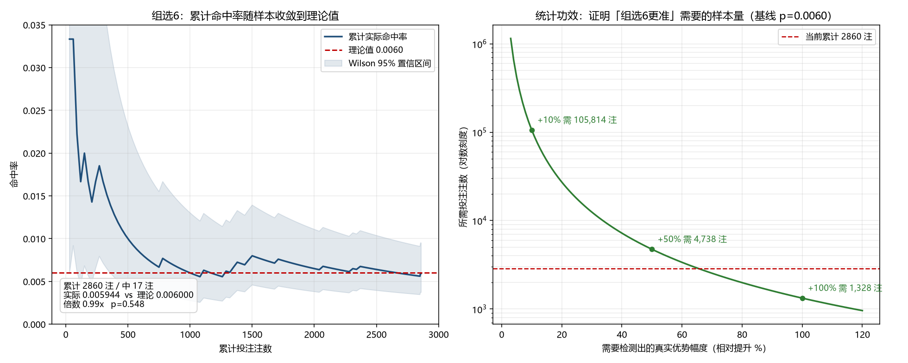
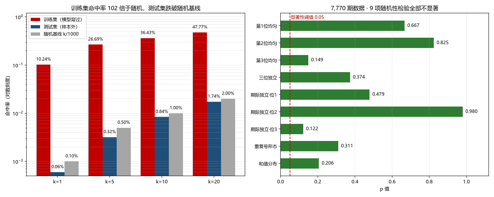

# 排列3 Analysis & Number-Picking Toolkit

[](https://github.com/kenshine0083-dot/LotteryPredictor/actions/workflows/ci.yml)
[](./LICENSE)
[](./requirements-core.txt)

[简体中文](./README.md) | **English**

> **This tool does not predict lottery numbers.** It generates distinct candidate
> combinations, computes the exact win probability and expected loss of every bet,
> tests whether the draw history differs from independent uniform randomness, and
> audits its own long-run record.

If you are looking for "what will be drawn next", it is not here — and on this
dataset it cannot be. The reasoning is below.

---

## Key Findings

Nine chi-square tests on the bundled 7,770 real draws (China Sports Lottery
「排列3」, periods 26295 → 4001), **all p > 0.05**:

| Test | p | Verdict |
|---|---|---|
| Uniformity of digit 1 / 2 / 3 | 0.67 / 0.82 / 0.15 | consistent |
| Independence between the three digits | 0.37 | consistent (999 of 1000 combinations observed) |
| Period-to-period independence, digit 1 / 2 / 3 | 0.48 / **0.98** / 0.12 | consistent |
| Repeat pattern (all distinct / one pair / triple) | 0.31 | consistent (0.7122 / 0.2776 / 0.0102) |
| Sum distribution | 0.21 | consistent (mean 13.604 vs theoretical 13.5) |

**Multiple comparisons.** These nine tests form one family: judging each at
α = 0.05 gives about `1 − 0.95⁹ ≈ 37%` chance of at least one false positive even
on perfectly random data. The overall conclusion therefore uses
**Holm-Bonferroni adjusted p-values** (FWER control). After correction,
**zero** tests are significant — none reaches the bar for rejecting randomness.

The data are compatible with independent uniform randomness, so there is no
structure a model could exploit. It follows strictly that:

> Any k distinct bets have a single-draw win probability of exactly k / 1000,
> **regardless** of which model, algorithm, or "pattern" produced them.

All three bet types return about **52%** of the stake in expectation; buying k
bets has an expected net result of about **−0.96 × k CNY**, getting linearly worse.

---

## Quick Start

Full GUI / model: Python 3.8–3.11 (TensorFlow 2.13 has no wheel for 3.13).

```bash
pip install -r requirements.txt
python main.py
```

Statistics, reproduction and CI need only the lightweight core (Python 3.8–3.13):

```bash
pip install -r requirements-core.txt
python reproduce.py
python test_core.py
```

A TensorFlow-free GUI build is also available; see [BUILD.md](./BUILD.md).

---

## Accounting: the Part Most Often Misread

- `score` in a picks file is a **model score / ordering value**, not a win
  probability, and never changes the coverage of a bet.
- Real win probability = number of distinct bets × per-bet coverage:
  直选 1/1000, 组选6 6/1000, 组选3 3/1000 per bet.
- The GUI shows cost, expected loss and the theoretical rate next to every
  generated set of numbers. Numbers appear only in "generate N bets", never as
  "next draw prediction".
- Every picks archive carries `schema_version` (currently **v2**) and a `note`
  stating the above. Older files without the field are read as v1; future
  versions are rejected.

Data provenance, field semantics, incremental update and known limits are in
[DATA_SOURCES.md](./DATA_SOURCES.md); machine-checkable declarations live in
`config.json → data_source`.

---

## Command-Line Tools

```bash
# Reproduce every number in the README from the bundled public data
python reproduce.py
python test_core.py

# Nine randomness tests (Holm-adjusted report); parameterised by digits / base
python randomness.py
python randomness.py --list-profiles
python randomness.py --profile d2-b6 --data other_draws.csv
python randomness.py --digits 2 --base 6 --json > result.json

# Cross-archive cumulative audit and single-file settlement
python audit.py
python settlement.py --file picks/picks_xxx.json

# Audit your OWN betting records (CSV / JSONL / JSON), fully local
python audit_external.py --template-out my_records.csv
python audit_external.py --file my_records.csv
python audit_external.py --file my_records.jsonl --json

# Simulation, plots, aggregate export (see README.md for details)
python simulation.py
python plot_audit.py
```

`randomness.analyze(data, digits=3, base=10)` works for any equal-probability
digital lottery with d digits in `[0, base)`. Theoretical distributions are
derived by exact integer counting (Stirling numbers of the second kind for
repeat patterns, convolution for sums); degrees of freedom adapt to the spec.
The default `(3, 10)` output is bit-for-bit identical to the old hardcoded version.

`audit_external.py` reuses `audit.summarize()` / `format_audit()` rather than
reimplementing statistics, so your records are judged by exactly the same
criteria as the project's own archives. It never writes back to
`audit_aggregate.json` or `picks/`.

---

## Its Own Track Record

Across 2,860 bets in its own archives: 17 wins, hit rate **0.005944** vs the
theoretical **0.006000**, one-sided binomial **p = 0.548**, net **−2,779 CNY**,
actual return rate **51.4%**. In other words, indistinguishable from random
picking, and losing money at the expected rate.

Statistical power: to prove a genuine edge at α = 0.05 / power 0.80 for 组选6
(p₀ = 0.0060), you would need roughly **106,000 bets** for a +10% lift,
**4,738** for +50%, and **1,328** for +100%. The current 2,860 bets are far
below that. Any "hit rate above theory" at this sample size is noise.



---

## `kronos_migration/` — a Falsification Experiment

The Kronos-style hierarchical-token / autoregressive idea was ported here:
coarse token → draw shape (all distinct / one pair / triple, 720 / 270 / 10
ordered outcomes), fine token → numbers within the shape,
`P(number) = P(shape) × P(number | shape)`. A 0.54M-parameter decoder-only causal
Transformer over a 1,000-dimensional joint distribution was trained on CPU.

Result: top-1 hit rate **10.24%** on the training set (102× random) but **0.06%**
out of sample (0.64× the random baseline). The model memorises; it does not
learn. That is why the UI never offers a "next draw" prediction.



---

## Testing & Continuous Integration

| Command | Checks | Where |
|---|---|---|
| `python test_core.py` | statistical core, no TF / no tkinter | CI, Python 3.11 + 3.13 |
| `python reproduce.py` | recomputes README numbers + data provenance | CI |
| `python pre_commit_checks.py` | 6 static self-checks | CI + local pre-commit hook |
| `python test_pipeline.py` | full pipeline incl. GUI, model, state round-trip | local, needs TF + display |

`test_core.py` also guards the architecture: core modules must not import
TensorFlow / keras / sklearn / tkinter at module level. The full pipeline suite
is intentionally kept off CI (TF 2.13 pins Python ≤ 3.11 and needs a display).

`reproduce.py` verifies that documented numbers can be recomputed from the
public data by the same code; it does **not** verify that the statistical
algorithms themselves are correct — that is the job of the two test suites.

---

## Why There Is No "Predicted Number"

Under the verified null hypothesis, every specific three-digit combination has
the same 1/1000 chance. Printing one would be read as a prediction, so the
project deliberately removed that output. Numbers appear only in "generate N
bets", always together with the true probability, cost and expected loss.

---

## Disclaimer

This is a statistical audit toolkit, not betting advice and not a gambling
product. Lottery play has negative expected value. The bundled data come from a
public endpoint and are provided without any official licence or guarantee of
completeness; see `DATA_SOURCES.md`. Do not commit personal betting records —
`picks/` and `saved_state/` are gitignored.

## License

MIT — see [LICENSE](./LICENSE).

Full change history: [CHANGELOG.md](./CHANGELOG.md).
Release notes draft: [RELEASE_NOTES.md](./RELEASE_NOTES.md).
