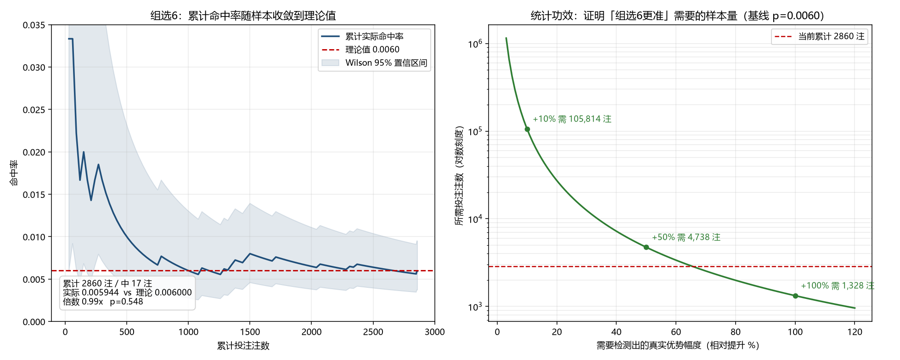
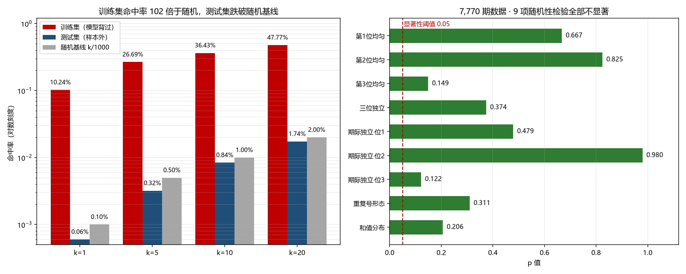

# 排列3 分析与选号工具

[English](./README.en.md) | **简体中文**

[](https://github.com/kenshine0083-dot/LotteryPredictor/actions/workflows/ci.yml)
[](./LICENSE)
[](./requirements-core.txt)

> **这个工具不预测号码。** 它做的事情是：给出互不重复的候选组合、算清每一步的真实中奖概率与期望亏损、验证历史数据是否真的随机、并长期审计自己的选号表现。

如果你是想找「下一期会开什么」的工具，这里没有，也无法有 —— 原因写在下面的结论里。

---

## 先说结论

用本项目自带的 7,770 期真实开奖数据（体彩排列3，期号 26295 → 4001）做九项统计检验，**全部 p > 0.05**：

| 检验项 | p 值 | 结论 |
|---|---|---|
| 第 1 / 2 / 3 位数字均匀性 | 0.67 / 0.82 / 0.15 | 符合 |
| 三位数字相互独立性 | 0.37 | 符合（1000 种组合已出现 999 种） |
| 第 1 / 2 / 3 位期际独立性 | 0.48 / **0.98** / 0.12 | 符合 |
| 重复号形态（组6/组3/豹子） | 0.31 | 符合（观测 0.7122 / 0.2776 / 0.0102） |
| 和值分布 | 0.21 | 符合（均值 13.604，理论 13.5） |

**多重比较校正**：九项检验属于同一个检验族，逐项裸判 α=0.05 时，即使数据完全随机，也约有 `1 - 0.95⁹ ≈ 37%` 概率至少出现一项 p<0.05。因此整体结论一律以 **Holm-Bonferroni 校正后**的 p 值为准（`randomness.py` 同时返回原始 p、校正后 p 与两者各自的判定）。本数据集校正后显著项数为 **0**，即没有一项够得上「拒绝随机」的门槛。

数据与「独立均匀随机」完全相容，**不存在可被模型利用的结构**。由此可以严格推出：

> 任意 k 注互不重复的选号，单期中奖概率恒为 k / 1000，与用什么模型、什么算法、什么「规律」选出这 k 注**完全无关**。

三种玩法的返奖率都约 **52%**，买 k 注的期望净收益约 **-0.96 × k 元**，随注数线性变差。

---

## 快速开始

**完整功能（GUI / 模型）**：Python 3.8–3.11（本项目 `.venv` 为 3.8.8）。TensorFlow 2.13 在 Python 3.13 上没有 wheel，装不上。

```bash
pip install -r requirements.txt
python main.py
```

**只用统计核心、复现结论或跑 CI**：不需要 TensorFlow，Python 3.8–3.13 都可以，装四个轻量包即可：

```bash
pip install -r requirements-core.txt
python test_core.py          # 100 项统计核心测试
python reproduce.py          # 61 项文档数字、数据来源与玩法规格复现
```

依赖分层见 [`requirements-core.txt`](./requirements-core.txt)，CI 在 Python 3.11 与 3.13 两个版本上验证。

**数据**：`历史数据.xlsx`，两列 —— `Period`（期号，降序）、`Numbers`（空格分隔的三位数字）。来源接口、字段口径、增量更新方式与已知限制见 [`DATA_SOURCES.md`](./DATA_SOURCES.md)；机器可核对的声明在 `config.json` → `data_source`，由 `reproduce.py` 逐项比对。

**配置**：`config.json`

| 字段 | 说明 |
|---|---|
| `default_file_path` | 历史数据文件（相对路径按本文件目录解析，与 CWD 无关） |
| `fetch_url` | 体彩官方接口，`{page_size}` / `{page_no}` 为占位符 |
| `save_dir` | 模型与 scaler 的保存目录 |

---

## 界面上的按钮，分别做什么

| 按钮 | 作用 |
|---|---|
| 初次运行 | 读数据 → 训练 → 输出结论（**不给出号码**） |
| 继续运行 | 加载上次训练状态 → 输出结论（**不给出号码**） |
| 更新数据 | 从体彩官方接口增量拉取最新开奖，写回 xlsx |
| 生成 N 注选号 | 给出 N 注互不重复组合 + 单期中奖概率 + 成本 + 期望亏损 |
| 命中率回测(基线对照) | 严格时序回测（预测第 t 期只用 `data[:t]`），与随机基线对照 |
| 命中模拟(历史回放) | 在历史区间上按指定玩法回放，可选随机选号或模型选号 |
| 预算规划选号 | 给定预算，输出三种玩法的命中概率与期望对照 |
| 累积审计（模型 vs 随机） | 汇总全部历史存档，按注级口径做二项检验与功效分析 |
| 数据随机性检验 | 对当前数据跑九项卡方检验 |
| 中断 | 中止训练线程 |

「初次运行 / 继续运行」故意只输出结论不给号码 —— 见下方「为什么没有预测号码」。

---

## 账目口径（最容易误读的部分）

| 玩法 | 单注中奖概率 | 单注固定奖金 | 最大注数 |
|---|---|---|---|
| 直选 | 1/1000 | 1040 元 | 1000（覆盖全部号码） |
| 组选3 | 3/1000 | 346 元 | 90（覆盖 270/1000，开奖为全不同或豹子时全不中） |
| 组选6 | 6/1000 | 173 元 | 120（覆盖 720/1000，开奖为组3或豹子时全不中） |

三个概念必须分清：

1. **模型打分**（结果区里显示为「模型打分 0.01426」）—— 只决定从全部组合里挑哪 N 注，**不是中奖概率**。无论打分多少，直选每注恒为 1/1000，组选6 每注恒为 6/1000。
2. **单期中奖概率** —— N 注互不重复时恒为 N × 单注概率，与选号方式无关。
3. **期望回报** —— 中奖概率 × 单注奖金。返奖率约 52%，即长期亏损率约 48%。

`picks/` 下的每份存档都带 `schema_version`（当前 **v2**）与 `note` 字段，把这些口径写死在文件里，避免日后翻看时误读。早期没有版本字段的存档按 v1 读取；高于当前版本的存档会被拒绝，避免用旧代码误读未来的格式。

---

## 命令行工具

`randomness.py` / `audit.py` / `settlement.py` / `reproduce.py` / `test_core.py` 只依赖标准库 + numpy/pandas/scipy/openpyxl，秒级启动，不需要 TensorFlow 与 tkinter。组合枚举与排序已抽到无 TF 依赖的 `combos.py`，因此 `simulation.py` 的随机基线回放同样轻量；只有显式的 `--with-ml` 分支才在运行时延迟导入 TensorFlow。

```bash
# 一键复现：把 README 里每个数字重算一遍，逐项 PASS/FAIL（干净 clone 即可跑）
python reproduce.py
python reproduce.py --json            # 机器可读结果，供 CI 使用

# 统计核心测试：零 TF / 零 tkinter，CI 跑的就是这条
python test_core.py
python test_core.py --json

# 九项随机性检验（报告含 Holm 校正后 p 值；默认读 config 指定的数据文件）
python randomness.py

# 检验与玩法无关：digits 位、每位 [0, base) 的等概率玩法都能用
python -c "import numpy as np, randomness as r; d=np.random.default_rng(0).integers(0,6,size=(4000,2)); print(r.format_report(r.analyze(d, digits=2, base=6)))"

# 跨存档累积审计：注级命中率、Wilson 区间、单边二项检验、统计功效
python audit.py
python audit.py --dir picks --excel 历史数据.xlsx

# 单份 picks 对账
python settlement.py --file picks/picks_26295_组选6_xxx.json

# 历史回放模拟
python simulation.py --mode 组选6 --bets 30 --selection random --eval-len 300

# 累计命中率收敛曲线 + 功效曲线（需要 matplotlib，项目 venv 未装）
python plot_audit.py

# 仅本地维护用：从自己的 picks/ 重新导出脱敏聚合数据
python export_aggregate.py
python export_aggregate.py --check    # 校验已发布数据与本地存档是否一致

# 换玩法：任意「d 位 / 每位 [0, base)」等概率数字玩法
python randomness.py --list-profiles
python randomness.py --profile d2-b6 --data 其他数据.csv
python randomness.py --digits 2 --base 6 --json > result.json

# 审计自己的投注流水（纯本地，绝不写回仓库发布数据）
python audit_external.py --template-out my_records.csv
python audit_external.py --file my_records.csv
python audit_external.py --file my_records.jsonl --json

# 提交前自检（pre-commit 与 CI 共用同一脚本）
python pre_commit_checks.py
```

---

## 一键复现

README 里的结论全部由真实数据算出，但 `picks/`（个人投注记录，含期号、时间戳、选号）与模型权重出于隐私和体积考虑**不在仓库里**。如果什么都不做，别人 clone 下来只能读结论、不能验结论 —— 这对一个以「严谨」立身的项目是自相矛盾的。

解决办法是 `audit_aggregate.json`：把对账结果压成**纯数值的逐期记录**，每条只有四个数（当期注数 / 中奖注数 / 成本 / 回报）。不含期号、开奖号码、选号、存档文件名、时间戳；逐期顺序还用固定种子打乱过，因此连「第几期命中」也无法对应回真实期号。所有汇总统计（总注数、命中率、Wilson 区间、二项检验 p、净损益、返奖率）都能从这些数值重新算出。

```bash
git clone https://github.com/kenshine0083-dot/LotteryPredictor.git
cd LotteryPredictor
pip install -r requirements-core.txt
python test_core.py
python reproduce.py
```

输出 61 项逐项比对（其中 7 项核对数据来源、5 项核对玩法规格声明），例如：

```
[PASS] 开奖期数                     重算 7770.0     声明 7770.0
[PASS] p值 · 第2位期际独立性       重算 0.980107   声明 0.98
[PASS] Holm 校正后显著项数         重算 0.0        声明 0.0
[PASS] 组选6 · 投注注数           重算 2860.0     声明 2860.0
[PASS] 组选6 · 单边二项 p         重算 0.547924   声明 0.548
[PASS] 组选6 · 净损益             重算 -2779.0    声明 -2779.0
[PASS] 功效 · 直选 +10% 所需注数  重算 638191.47  声明 638191.0
```

`reproduce.py` 复用项目本体的代码路径（`randomness.analyze` / `evaluation.wilson_interval` / `audit._binom_p` / `audit.required_samples`），并把 README 的声明值写成 `EXPECTED` 常量。**文档改了数字而脚本没同步，复现就会失败** —— 它就是用来防止结论与数据在后续维护中悄悄漂移的。

需要划清的边界：它验证的是「文档数字能否由仓库内公开数据经同一套代码重算出来」，**不验证统计算法本身是否正确**，后者由 `test_core.py`（CI 中持续运行）与 `test_pipeline.py`（本地全量）覆盖。

数据来源那 7 项核对的是 `历史数据.xlsx` 自身：期数、期号范围、列名、期号唯一性、开奖号格式是否与 `config.json` → `data_source` 一致，`DATA_SOURCES.md` 是否随仓库发布。数据文件被替换或悄悄改动时，复现会立即失败。

玩法规格那 5 项核对 `config.json` → `game_profile` 与 `randomness.PROFILES` / 默认参数是否一致（位数、每位取值数、结果空间 1000）。换玩法只改命令行参数，不改配置文件；声明与代码不一致时复现会失败。

---

## 实测：它自己的账

截至 2026-11-07，用真实跑过的存档做累积审计：

| 玩法 | 存档 | 期号 | 投注 | 中奖 | 实际命中率 | 理论 | 倍数 | 单边二项 p |
|---|---|---|---|---|---|---|---|---|
| 组选6 | 3 份 | 95 | 2,860 注 | 17 注 | 0.005944 | 0.006000 | **0.99x** | 0.548 |
| 直选 | 2 份 | 1 | 10 注 | 0 注 | 0 | 0.001000 | 0.00x | 1.000 |

组选6 累计成本 5,720 元、回报 2,941 元、**净亏 2,779 元**，实际返奖率 51.4% —— 与官方设计的 52% 精确吻合。

**统计功效**（说明「命中率超常」这件事有多难成立）：

| 要检测的优势 | 需要的注数 | 每期 5 注时 |
|---|---|---|
| 直选 +10% | 638,191 注 | 约 350 年 |
| 直选 +50% | 28,602 注 | 约 16 年 |
| 直选 +100% | 8,026 注 | 约 4 年 |

样本量远小于这些数字时，任何「命中率高于理论」都只是随机波动，不构成证据。



_图 1：左为组选6 累计命中率随注数收敛到理论值 0.0060（浅色为 Wilson 95% 区间）；右为以组选6 基线 p=0.0060 计算的功效曲线，标注 +10% / +50% / +100% 优势分别需要约 10.6 万 / 4,738 / 1,328 注，红色虚线是当前累计 2,860 注。由 `plot_audit.py` 生成（需要 matplotlib）。_

---

## 模块

| 文件 | 职责 |
|---|---|
| `main.py` | 入口，装配 DataProcessor / LotteryModel / GUI |
| `paths.py` | 配置读取与相对路径解析（单独抽出，避免 CLI 拖入 TensorFlow） |
| `data_processor.py` | 读取 xlsx、特征工程、增量更新、状态存取 |
| `lottery_model.py` | Transformer 编码器 + 三头 softmax；重新导出 `combos.py` 的实现保持旧调用兼容 |
| `combos.py` | 组合枚举 / 排序 / 滑窗的纯计算层，无 TF 依赖 |
| `evaluation.py` | 玩法规则、注数账目、预算规划 |
| `settlement.py` | picks 存档、按开奖结果对账 |
| `simulation.py` | 严格时序回测与历史回放 |
| `randomness.py` | 玩法无关的卡方检验（`digits` / `base` 可参数化）+ Holm 多重比较校正 |
| `audit.py` | 跨存档累积审计、Wilson 区间、二项检验、功效分析 |
| `reproduce.py` | 一键复现：把 README 声明值逐项与仓库数据重算结果比对 |
| `export_aggregate.py` | 从本地 `picks/` 导出脱敏逐期聚合数据（仅维护用） |
| `gui.py` | Tkinter 界面；所有耗时操作走后台线程，结果经队列回主线程 |
| `plot_audit.py` | 审计结果可视化（需 matplotlib） |
| `audit_external.py` | 审计自己的外部投注流水（CSV / JSONL / JSON），复用 `audit.summarize` |
| `main_lite.py` / `build_exe.py` | 无 TF 的轻量 GUI 入口与 PyInstaller 构建脚本，见 `BUILD.md` |
| `pre_commit_checks.py` / `.pre-commit-config.yaml` | 6 项静态自检，CI 与本地钩子共用 |
| `test_pipeline.py` | 本地全链路测试，138 项（需 TF 与显示环境） |
| `test_core.py` | 统计核心测试，100 项（零 TF / 零 tkinter，CI 入口） |
| `requirements-core.txt` | 统计核心 / 一键复现 / CI 的最小依赖 |
| `.github/workflows/ci.yml` | GitHub Actions：自检 + 核心测试 + 文档数字复现，跨 Python 3.11 / 3.13 |
| `DATA_SOURCES.md` | 数据来源、字段口径、增量更新方式与已知限制 |
| `README.en.md` / `CHANGELOG.md` / `RELEASE_NOTES.md` | 完整英文文档、变更历史与发布说明草稿 |

运行时产物：

| 路径 | 内容 |
|---|---|
| `历史数据.xlsx` | 开奖历史（`Period` / `Numbers`），已随仓库发布 |
| `audit_aggregate.json` | 脱敏聚合数据，已随仓库发布，供 `reproduce.py` 复现结论 |
| `picks/` | 每次「生成 N 注选号」的存档，供单份对账与累积审计读取（**不随仓库发布**） |
| `saved_state/` | 训练好的模型（`model_*.h5`）、scaler 与元数据 |
| `tuner_dir/` | keras-tuner 的搜索记录 |

---

## 换玩法、外部流水与分发

### 换玩法

`randomness.analyze(data, digits=3, base=10)` 适用于任意「d 位、每位 `[0, base)`」的等概率数字玩法：理论分布由整数计数精确推出（重复形态用第二类 Stirling 数、和值用卷积），检验项数与自由度随规格变化，`digits=1` 自动跳过自由度为 0 的项。默认 `(3,10)` 的输出与旧版逐位一致。

| 模板 | 规格 | 结果空间 | 用途 |
|---|---|---|---|
| `arrange3` | 3 位 / 0-9 | 1000 | 本项目自带数据 |
| `d1-b10` | 1 位 / 0-9 | 10 | 最小退化用例 |
| `d2-b6` | 2 位 / 0-5 | 36 | 演示 |
| `d2-b10` | 2 位 / 0-9 | 100 | 演示 |
| `d4-b10` | 4 位 / 0-9 | 10000 | 较大空间 |

只有 `arrange3` 对应仓库数据；其余是通用规格模板，不声称对应任何具体彩票品种。数据可来自 `.xlsx` / `.csv`（`Numbers` 列为空格分隔数字串）或 `.npy`（形状 `(期数, digits)`）。`--json` 输出结构化结果便于接入别的工具。`config.json` → `game_profile` 声明默认规格，由 `reproduce.py` 逐项核对。

### 审计自己的投注流水

`audit_external.py` 把你在别处记录的逐期流水（CSV / JSONL / JSON）用**完全相同**的口径核对。字段：`mode`（直选 / 组选6 / 组选3）、`bets`、`wins`、`cost`、`payout` 为必填，`period` / `note` 可选。它把每条记录转成 `settlement.settle()` 的返回结构，直接调用 `audit.summarize()` 与 `format_audit()`，所以命中率、Wilson 区间、单边二项 p、返奖率、功效阈值与项目自身审计逐位一致。

```bash
python audit_external.py --template-out my_records.csv   # 生成模板（含两行示例）
python audit_external.py --file my_records.csv
python audit_external.py --file my_records.jsonl --anonymize-out aggregate.json
```

隐私边界：只读你显式指定的文件；报告只有聚合数字；`--anonymize-out` 仅导出 `bets/wins/cost/payout` 且固定种子打乱顺序；**绝不写回** `audit_aggregate.json`、`picks/` 或仓库内任何发布数据。仓库里那份脱敏数据只对应项目自身 99 份存档，不该被外部记录污染。

### 开发与分发

- `pip install pre-commit && pre-commit install`：启用格式钩子与 6 项项目自检；CI 跑的是同一个 `pre_commit_checks.py`，没装也能守住约束。
- `python build_exe.py --mode lite`：构建不含 TensorFlow 的 Windows GUI（本机实测约 190 MiB）；`--mode full` 打完整版。产物在 `dist/`，不进仓库。详见 `BUILD.md`。
- `CHANGELOG.md` 记录版本历史，`RELEASE_NOTES.md` 是发布正文草稿；本地 tag `v1.0.0` 对应首个可标记的稳定版。

---

## `kronos_migration/` —— 一个否证实验

把 [Kronos](https://github.com/shiyu-coder/Kronos)（金融 K 线基础模型）的「层级量化 + 先粗后细自回归」思想迁移到排列3 上：

| Kronos | 本项目映射 |
|---|---|
| 粗 token | 形态：组6 / 组3 / 豹子 |
| 细 token | 该形态下的具体号码 |
| 先粗后细解码 | P(号码) = P(形态) × P(号码 \| 形态) |

模型 0.54M 参数的 decoder-only Transformer，1000 维联合分布（而非三个位置的独立 softmax）。

**结论是否证的**，三重证据：数据无结构（9 项 p > 0.05）；样本外命中率是随机基线的 0.64–0.87 倍（p 值 0.78–0.89）；训练集 k=1 命中率 10.24%（102 倍）而测试集 0.06%（0.64 倍）—— 模型是在**记忆**，不是在学习。



_图 2：左为 k=1/5/10/20 时训练集、样本外测试集与随机基线的命中率（对数轴，k=1 分别为 10.24% / 0.06% / 0.10%）；右为 7,770 期数据的九项随机性检验 p 值，全部高于 0.05 显著性阈值。_

保留这套代码是因为三个工具仍有用：`analyze_randomness.py`（换任何玩法都能验数据）、`train_vs_test.py`（判断「真学到 vs 假学到」的通用框架）、`integration.py`（与 `predict_multiple` 同签名的对接层）。

---

## 测试

两套测试，互不替代：

| 命令 | 项数 | 环境 | 跑在哪 |
|---|---|---|---|
| `python test_core.py` | 100 | numpy/pandas/scipy/openpyxl，零 TF、零 tkinter | **CI 每次 push**，Python 3.11 + 3.13 |
| `python reproduce.py` | 61 | 同上 | **CI 每次 push**，核对 README 声明值、数据来源与玩法规格 |
| `python pre_commit_checks.py` | 6 | 仅标准库 | **CI 每次 push** + 本地 pre-commit 钩子 |
| `python test_pipeline.py` | 138 | 完整 `requirements.txt` + 显示环境 | 本地；含 GUI、模型训练与状态往返 |

`test_pipeline.py` 覆盖数据完整性、特征工程、模型训练与状态往返、三种玩法账目、picks 存档与对账（含 `schema_version` 兼容）、GUI 非阻塞与文案口径、随机性检验与 Holm 校正（含换玩法的通用化）、累积审计、脱敏聚合数据、一键复现、轻量入口与外部流水审计，以及 README 图片、英文文档与发布资产的存在性。

其中几项是刻意设置的反向断言：**GUI 输出里不允许出现「预测下一期」**；选号区**不允许**把模型打分标成「中奖概率」；纯随机数据**不允许**被误判为「有结构」；故意篡改 README 声明的数字时，一键复现**必须**失败。这样口径或结论一旦被改回去，测试会直接失败。

---

## 持续集成

[`.github/workflows/ci.yml`](./.github/workflows/ci.yml) 在 push 与 PR 时触发，做六件事：

1. 只装 `requirements-core.txt`（不装 TensorFlow / keras-tuner / scikit-learn），并显式断言环境里确实没有这些重依赖；
2. 全仓语法编译，包括 GUI 与模型模块 —— **只编译不导入**，因此不需要 TF 或显示器，并核对公开数据、图片、文档与构建资产齐全；
3. 跑 `pre_commit_checks.py --json`（6 项静态自检：私有文件、密钥字面量、`.gitignore`、依赖边界、编码、文档资产）；
4. 跑 `test_core.py --json`（100 项统计核心测试）；
5. 跑 `reproduce.py --json`（61 项，把 README 每个数字、数据来源与玩法规格重算一遍）；
6. 归档三份 JSON 结果供下载。

**为什么 CI 不跑那 138 项全量测试**：`test_pipeline.py` 顶层 `import tkinter`，且训练用例需要 TF 2.13，而 TF 把 Python 锁死在 3.8–3.11，Linux runner 还得配 xvfb 虚拟显示。把统计结论的持续验证绑在这套重环境上，既不快也不可靠。拆成核心层之后，CI 秒级完成，还能同时跑 Python 3.11 与 3.13 —— 后者正是 TF 装不上的版本，两者都绿才说明统计链路真的与模型环境解耦了。

`test_core.py` 里还有一条架构守卫：它用 AST 检查 `paths / evaluation / randomness / settlement / audit / export_aggregate / reproduce / audit_external / combos` 的**顶层 import**，一旦有人在这些模块里顺手加了 `import tensorflow`，CI 会直接变红。

---

## 为什么没有「预测号码」

1. 数据经检验与独立随机相容，没有可学的结构；
2. 在随机数据上，任何模型的期望命中率上限就是 k/1000，这是数学限制而非工程限制；
3. 具体号码的视觉冲击极强，一旦显示就会被当成「预测」，而它实际上等价于随机选号。

所以号码只出现在「生成 N 注选号」里，并且与真实概率、成本、期望亏损一起出现。

---

## English Summary

**This tool does not predict lottery numbers.** It is a statistical audit toolkit for the Chinese "排列3" (3-digit) lottery: it generates distinct candidate combinations, computes the exact win probability and expected loss of every bet, tests whether the draw history is distinguishable from independent uniform randomness, and audits its own long-run record.

Nine chi-square tests on 7,770 real draws all have p > 0.05. Because they form one family (about 37% chance of at least one false positive at α=0.05), the overall conclusion uses Holm-Bonferroni adjusted p-values; **zero** tests remain significant. Under this null, any k distinct bets have a single-draw win probability of exactly k/1,000 regardless of how those bets were chosen. All three bet types return about 52% of the stake in expectation, so buying more bets only increases the expected loss.

`kronos_migration/` is a falsification experiment: a 0.54M-parameter Kronos-style autoregressive Transformer reaches 10.24% top-1 hit rate on the training set but 0.06% out of sample (0.64× the random baseline). It memorises; it does not learn. The randomness tests are parameterised by `digits` and `base`, so the same code works for any equal-probability digital lottery.

Every number in this README is reproducible: `pip install -r requirements-core.txt`, then `python reproduce.py` (56 checks, no TensorFlow). Data provenance is documented in [`DATA_SOURCES.md`](./DATA_SOURCES.md). MIT licensed. Not betting advice; lottery play has negative expected value.

---

## 免责声明

本项目用于统计分析与自我审计，**不构成任何投注建议，也不承诺任何收益提升**。彩票是负期望游戏，长期必然亏损。

未满 18 周岁不得购买彩票。理性购彩，量力而行。

---

## 许可证

[MIT](./LICENSE) © 2026 kenshine

代码可自由使用、修改、分发，包括商业用途，保留版权声明即可。如果你把它用在自己的项目里，**建议同时保留 README 里「数据无结构、命中率上限 k/1000」这段结论** —— 去掉这段结论、只留选号功能，它就会变回一个误导人的工具。

